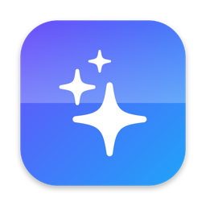
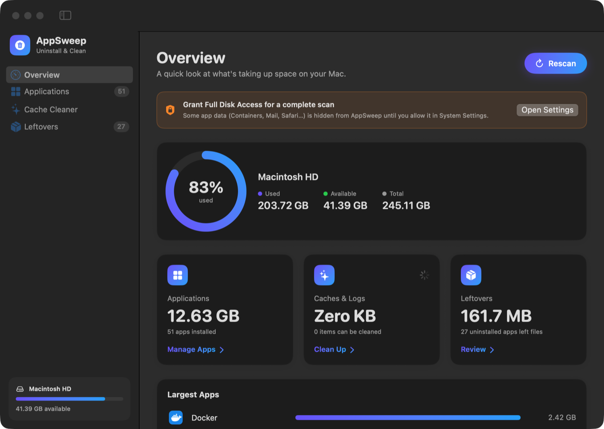
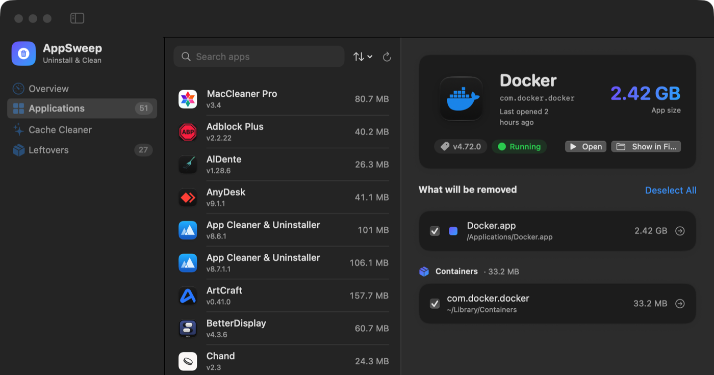
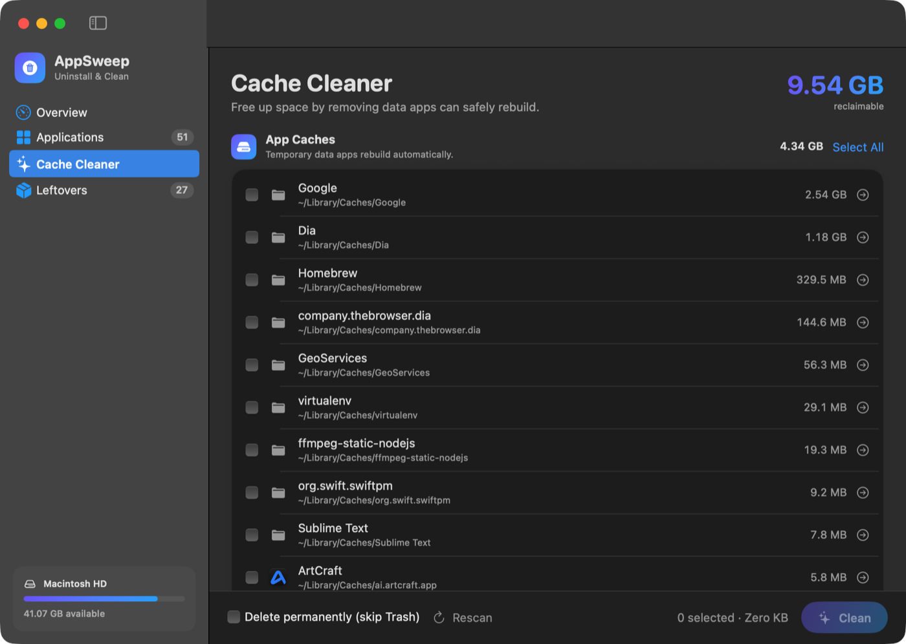
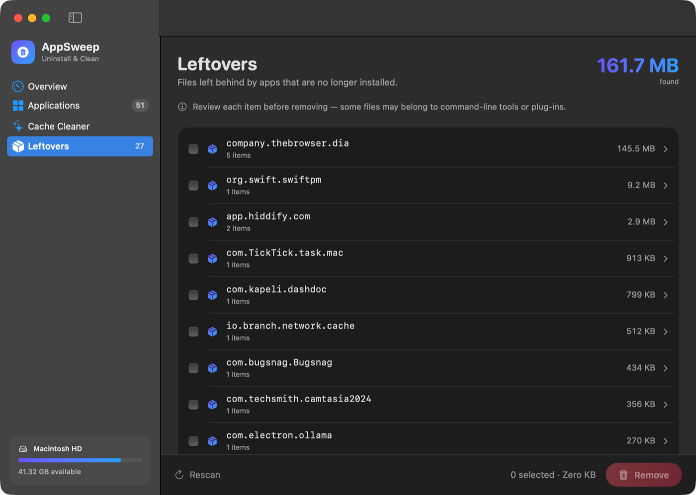
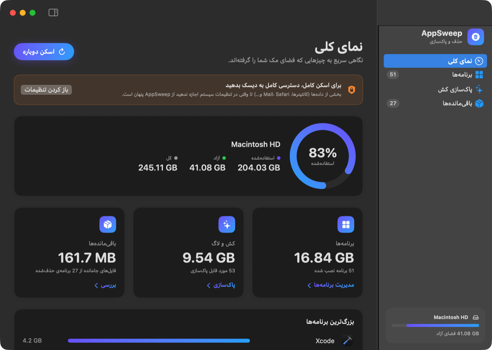

<div align="center">



# AppSweep

**Uninstall apps completely. Reclaim your disk space.**

A beautiful, native app cleaner for macOS — remove apps along with every file they leave behind,
clear caches, and find leftovers from apps you deleted long ago.

[](https://github.com/AliRazaviDeveloper/AppSweep/releases/latest/download/AppSweep.dmg)
[](#-platforms)
[](#-platforms)

[](https://github.com/AliRazaviDeveloper/AppSweep/releases/latest)
[](https://github.com/AliRazaviDeveloper/AppSweep/releases)
[](https://github.com/AliRazaviDeveloper/AppSweep/actions/workflows/ci.yml)


[](LICENSE)

[English](README.md) · [فارسی](README.fa.md)

<br>



</div>

---

## ✨ Features

| | |
|---|---|
| 🗑 **Complete uninstaller** | Dragging an app to the Trash leaves gigabytes behind. AppSweep finds everything an app stored — Application Support, Caches, Preferences, Containers, Group Containers, Logs, Saved State, Cookies, WebKit data and Launch Agents — and lets you choose exactly what goes. |
| 🔄 **Reset apps** | Keep the app, wipe its data. Untick the app bundle and remove only its settings and caches to start fresh. |
| ✨ **Cache Cleaner** | Clear app caches, logs and developer junk — Xcode DerivedData, Device Support, simulator caches, npm, Gradle and more. |
| 📦 **Leftovers finder** | Discover files left behind by apps you uninstalled long ago, grouped by app, with a full breakdown before anything is removed. |
| 📊 **Overview dashboard** | See disk usage, total app size, reclaimable space and your largest apps at a glance. |
| 🛡 **Safe by default** | Everything goes to the Trash so it can be restored. Running apps are quit gracefully first, and macOS system apps are protected. |
| 🖱 **Drag & drop** | Drop any `.app` onto the window to inspect it instantly — even apps outside `/Applications`. |
| 🌍 **English & فارسی** | Fully localized, including a native right-to-left layout for Persian. |

## 📸 Screenshots

<table>
  <tr>
    <td></td>
    <td></td>
  </tr>
  <tr>
    <td align="center"><b>Uninstall apps with all their files</b></td>
    <td align="center"><b>Clean caches & developer junk</b></td>
  </tr>
  <tr>
    <td></td>
    <td></td>
  </tr>
  <tr>
    <td align="center"><b>Find leftovers of deleted apps</b></td>
    <td align="center"><b>Native right-to-left Persian UI</b></td>
  </tr>
</table>

## 💻 Platforms

| Platform | Status | Download |
|---|---|---|
| **macOS** 14 Sonoma or later — Apple Silicon & Intel | ✅ Available | [**AppSweep.dmg**](https://github.com/AliRazaviDeveloper/AppSweep/releases/latest/download/AppSweep.dmg) |
| **Windows** 10 / 11 | 🚧 Coming soon | — |
| **Linux** | 🚧 Coming soon | — |

> ⭐ **Star** or **Watch → Custom → Releases** on this repository to be notified when the Windows and Linux versions ship.

## 📥 Installation

### Option 1 — One-line install (recommended)

Paste this into **Terminal**:

```bash
curl -fsSL https://raw.githubusercontent.com/AliRazaviDeveloper/AppSweep/main/install.sh | bash
```

It downloads the latest release, installs it into **Applications** and opens it — no security prompts.

### Option 2 — Download the DMG

1. Download **[AppSweep.dmg](https://github.com/AliRazaviDeveloper/AppSweep/releases/latest/download/AppSweep.dmg)**.
2. Open it and drag **AppSweep** into your **Applications** folder.
3. Run this once in Terminal, then open AppSweep:

```bash
xattr -dr com.apple.quarantine /Applications/AppSweep.app
```

<details>
<summary><b>Why is step 3 needed?</b></summary>

<br>

AppSweep isn't notarized by Apple yet, so when it's downloaded through a browser macOS shows
*"Apple could not verify AppSweep…"* and offers **Move to Trash**. The app is safe — the command above
simply removes the download quarantine flag. Alternatively, click **Done**, then open
**System Settings → Privacy & Security** and click **Open Anyway**.
The one-line installer avoids this entirely.

</details>

<details>
<summary><b>Recommended: grant Full Disk Access</b></summary>

<br>

macOS hides some app data (such as sandboxed containers) from other apps. For the most complete scan, open
**System Settings → Privacy & Security → Full Disk Access**, click **+** and add AppSweep.
AppSweep shows a shortcut to this screen when access is missing.

</details>

## 🔒 Privacy

AppSweep runs entirely on your Mac. It has **no network access, no analytics and no accounts** — nothing you scan ever leaves your computer.

## 🛠 Building from source

Requirements: macOS 14+ and Xcode 16 (or the Xcode Command Line Tools).

```bash
git clone https://github.com/AliRazaviDeveloper/AppSweep.git
cd AppSweep

swift run              # build & run a debug build
./build.sh             # universal release build → dist/AppSweep.app and dist/AppSweep.dmg
```

### Project structure

```
Sources/AppSweep/
├── AppSweepApp.swift        # App entry point, settings
├── Core/
│   ├── AppModel.swift       # Observable app state & actions
│   ├── Models.swift         # Data types
│   └── Scanners.swift       # App, related-file, cache & leftover scanners, safe removal
└── Views/                   # SwiftUI screens and components
Resources/                   # Info.plist, icon, localizations (en, fa)
```

## 🗺 Roadmap

- [x] Complete uninstaller with related-file detection
- [x] Cache, log & developer-junk cleaner
- [x] Leftovers finder
- [x] English & Persian localization
- [ ] Notarized builds & in-app updates
- [ ] Monitor `/Applications` and offer cleanup when an app is dragged to the Trash
- [ ] Large & old files finder
- [ ] Windows version
- [ ] Linux version

## 🤝 Contributing

Bug reports and feature requests are welcome — please [open an issue](https://github.com/AliRazaviDeveloper/AppSweep/issues/new/choose).
Pull requests are appreciated; for larger changes, open an issue first to discuss what you'd like to change.

## 📄 License

Released under the [MIT License](LICENSE). © 2026 Ali Razavi.
